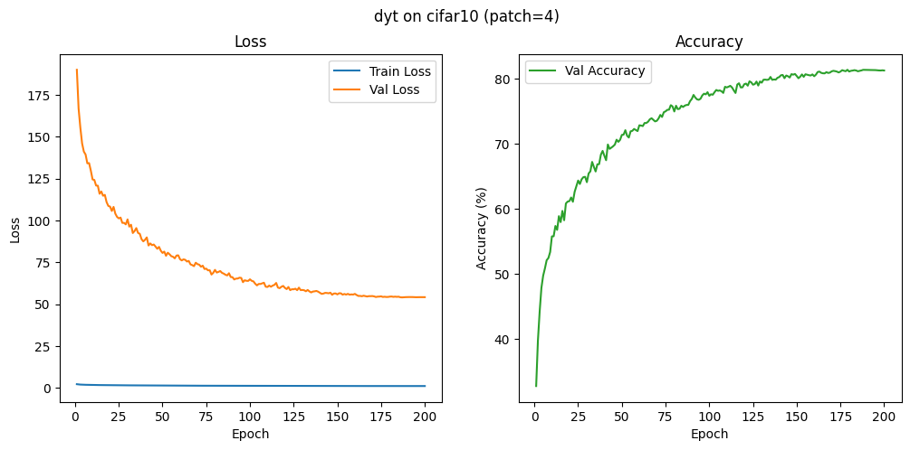

# DyT CIFAR-10 Notebook

## Research Papers
- **Vision Transformer (ViT)** — Dosovitskiy et al., "An Image is Worth 16x16 Words: Transformers for Image Recognition at Scale" (ICLR 2021). ViT introduced patch embeddings plus transformer encoders for vision, which DyT inherits.
- **Dynamic Tanh Transformer (DyT)** — Zhu et al., "Transformers without Normalization" (2025). DyT swaps LayerNorm for learnable Dynamic Tanh blocks, improving stability on small datasets like CIFAR-10.

## Techniques and Features
- Runs entirely inside `dyt_cifar10.ipynb`, keeping the training recipe self-contained for notebook-friendly work.
- CIFAR-10 preprocessing includes RandAugment (N=2, M=9), random crop/flip, and normalization, followed by mixup (α=0.1) within each training batch.
- DyT (defined in the notebook) is built with patch embeddings, Dynamic Tanh in place of normalization, and a cosine-scheduled AdamW optimizer with AMP scaling to stay within an 8–10 GB VRAM budget.
- Automatic resume: complete checkpoints, EMA weights, diagnostic histories, and CSV metrics are uploaded to the configured Hugging Face model repository every five epochs. Checkpoints in the selected run folder resume automatically. Configuration mismatches or invalid checkpoints stop with an error; they are never silently bypassed.
- Matplotlib plotting saves `plots/dyt_cifar10_training.png` for quick loss/accuracy inspection, and `plots/.gitkeep` keeps the folder in the repo.

## Tips and Tricks
1. Run the notebook in Jupyter or Colab so you can rerun individual cells; the checkpoint system makes it safe to interrupt the kernel.
2. Adjust a single config cell (batch size, dim, depth, learning rate) instead of spreading flags across multiple scripts.
3. Keep the large folders (`Vit-Dyt/data`, `checkpoint`, `log`, `wandb`) out of Git—they are ignored, so they can grow locally without affecting pushes.
4. After training, re-open `plots/dyt_cifar10_training.png` to verify the learning curves before sharing results.

## Training experiments

The notebook defaults to averaging the 64 patch tokens before the final DyT and head, Xavier initialization of the flattened patch projection, a 300-epoch schedule (10 warmup epochs, peak LR 3e-4, minimum LR 1e-6), progressively increasing DropPath up to 0.1, and EMA decay 0.9999. Raw and EMA validation accuracy are evaluated each epoch, alongside clean training accuracy without random augmentation or mixup.

For a pooling-only comparison, use `PATCH_INIT="kaiming"`, `DROP_PATH_RATE=0.0`, `TOTAL_EPOCHS=200`, and `MIN_LEARNING_RATE=1e-5`, then compare `POOLING="cls"` with `POOLING="mean"`. Restart the kernel for each run and keep the remaining settings fixed.

Select hyperparameters and raw versus EMA weights on the 45k/5k split. Then restart with `FINAL_TRAINING=True` and the chosen `FINAL_EVAL_WEIGHTS` to train from scratch on all 50,000 images. The final cell evaluates the test set only in this mode, once per session. Set `HF_EXPERIMENT_FOLDER` to a new folder for each experiment. The default `checkpoints/mean-pooling-ema` has separate `validation` and `final-50k` subfolders in the existing repository. All uploaded checkpoints, CSVs, and plots use the selected run folder; previous root files are preserved. Folders appear on the first upload.
